<!--
  ─────────────────────────────────────────────────────────────────────────────
  JAMAL ADEMOLA — PORTFOLIO README v5.0
  ─────────────────────────────────────────────────────────────────────────────
  ⚠️  GitHub strips ALL style="" attributes, <style> tags and classes from
      READMEs. That's why every visual effect here lives inside the SVGs in
      ./assets (CSS animations inside an SVG still run on GitHub).
  📱  Mobile: everything is a single column. Images have fixed widths, and
      GitHub's own CSS (img { max-width:100% }) shrinks them on small screens.
      Badges are separate s, so they wrap onto new lines on a phone.
  ✏️  To update links, search for "@CONFIG".
  🖼️  Your own hero.svg, beam.svg, orbit.svg and wave.svg are reused as-is.
  🐍  Snake: generated by .github/workflows/snake.yml onto the "output"
      branch. Never merge that branch into main.
  ─────────────────────────────────────────────────────────────────────────────
-->

<!-- @CONFIG: socials -->

  
  
  
  
  
  

<a href="#server-status">SERVER STATUS</a> ✦
<a href="#whoami">WHOAMI</a> ✦
<a href="#stack-orbit">STACK</a> ✦
<a href="#credentials">CREDENTIALS</a> ✦
<a href="#telemetry">TELEMETRY</a> ✦
<a href="#initiate-contact">CONTACT</a>

<!-- ═════════════════════════ MODULE 00 ═════════════════════════ -->

 

<h3>I'm Jamal — a full-stack & mobile developer who believes an interface isn't finished until it <i>feels alive</i>.</h3>

<!-- ═════════════════════════ MODULE 01 ═════════════════════════ -->

 

I'm **Jamal Ademola**, a full-stack & mobile developer with **4+ years** of turning ambitious ideas into fast, beautiful, production-grade software for a global clientele.

My work lives where two obsessions meet: **engineering that scales** and **interfaces that feel alive**. Clean architecture on the backend. GSAP timelines, buttery transitions and pixel-perfect detail on the frontend. And when the job needs to go native, **Kotlin** on Android and **C** when I want to be close to the metal.

From real-time collaboration systems to mobile apps that ship to the Play Store, I handle the whole journey:

**`concept`** → **`architecture`** → **`deployment`** → **`delight`**

 

<!-- ═════════════════════════ MODULE 02 ═════════════════════════ -->

 

  

<code>&nbsp;⟨ WEB ⟩&nbsp;</code> 

<code>&nbsp;⟨ BACKEND ⟩&nbsp;</code> 

<code>&nbsp;⟨ MOBILE · ANDROID · SYSTEMS ⟩&nbsp;</code> 
 

<code>&nbsp;⟨ DATA · CLOUD ⟩&nbsp;</code> 

<code>&nbsp;⟨ MOTION ⟩&nbsp;</code> 
 

<code>&nbsp;⟨ TOOLS ⟩&nbsp;</code> 

  

**`CORE`** &nbsp; Next.js ✦ NestJS ✦ React Native ✦ Kotlin 
**`MOTION`** &nbsp; GSAP ✦ Framer Motion ✦ Three.js

<!-- ═════════════════════════ MODULE 03 ═════════════════════════ -->

 

<!-- @CONFIG: credentials -->

 

 ↳ tap any badge to verify

<!-- ═════════════════════════ MODULE 04 ═════════════════════════ -->

 

<picture>
  <source media="(prefers-color-scheme: dark)" srcset="https://raw.githubusercontent.com/Jamal-09/Jamal-09/output/snake-dark.svg" />
  <source media="(prefers-color-scheme: light)" srcset="https://raw.githubusercontent.com/Jamal-09/Jamal-09/output/snake-light.svg" />
  
</picture>

<!-- ═════════════════════════ FINAL MODULE ═════════════════════════ -->

  

  

 
CRAFTED IN PIXELS &amp; MOTION BY JAMAL

